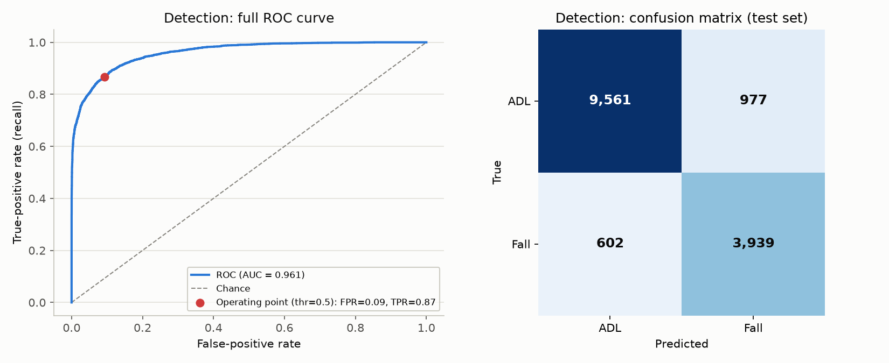
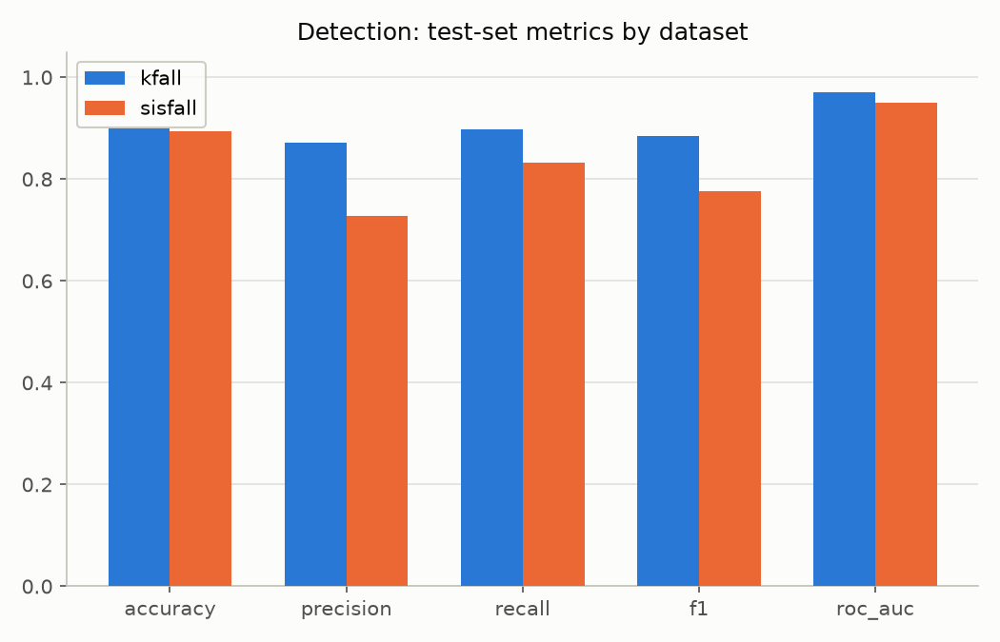
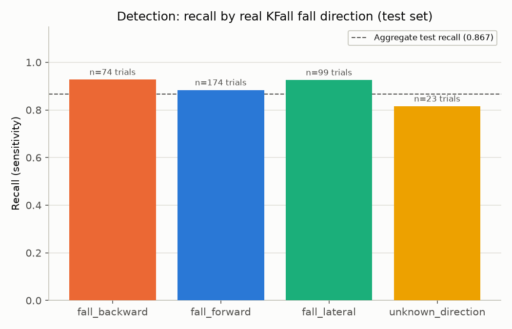
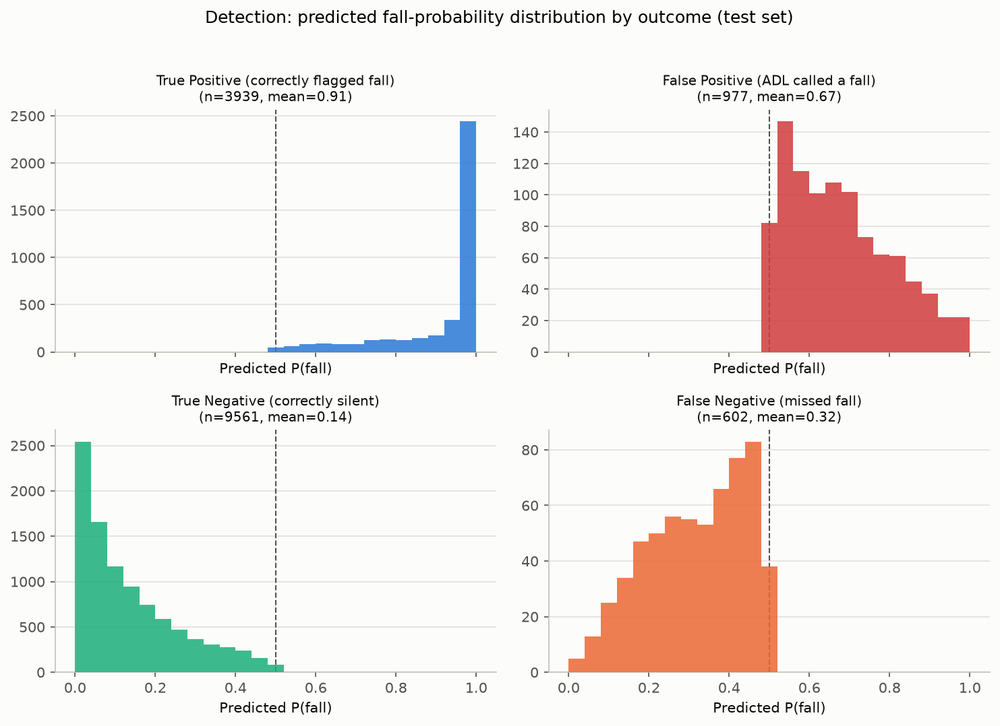
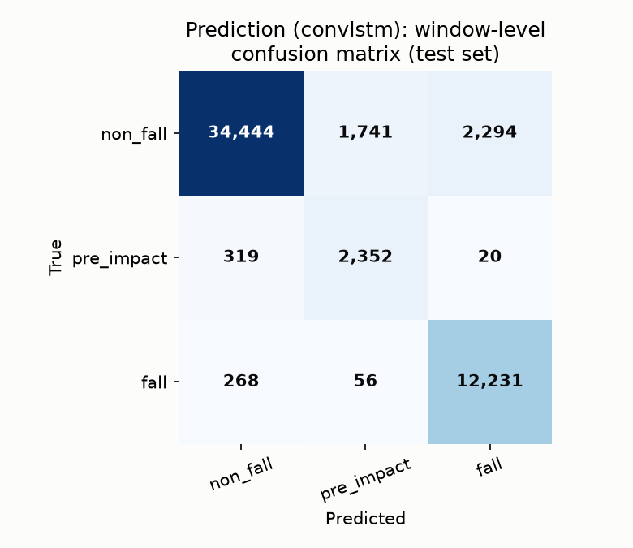
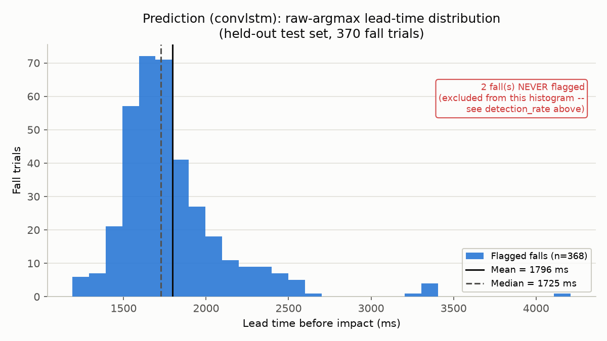

# ShravanAI — Comprehensive Statistical Evaluation (Detection + Prediction)

**Date:** 2026-07-22
All numbers were computed against the real code and checkpoints in `architecture/ShravanAI/`; figures are in `assets/eval_report/` and the raw values in `assets/eval_report/summary_stats.json`.

## What this document is, and isn't

`architecture/ShravanAI/results/*/evaluation_report.json` already records each model's
headline test-set numbers. This document does not repeat them. It exists to answer a different,
more specific question, on the user's explicit request: **are these two models actually
good enough to demonstrate live**, backed by statistics that go past the headline numbers —
full ROC curves, per-dataset and per-fall-direction breakdowns, confidence-calibration
views, lead-time distributions, and — for prediction specifically — both window-level and
event-level false-alarm/detection rates side by side, because those two can tell very
different stories for the same checkpoint.

Every number here comes from calling the real project code (`detection.model`,
`detection.split`, `prediction.predict`, `prediction.lead_time`,
`scripts/export_prediction_to_unity.py`'s own event-selection functions) against the real
trained checkpoints and the real, subject-aware held-out test splits — nothing is
reimplemented or copied from a doc. Full working code, with every print statement's real
output, is in the companion notebook; this document is the narrative summary of it.

**Before evaluating anything**, the notebook checked whether more real subject data exists
on disk than the harmonized manifest currently uses. It doesn't: all 32 KFall subject
folders and all 38 SisFall subject folders physically present on disk are already in the
manifest (9,580 real trials total). The held-out test splits below are genuinely the
largest real, subject-disjoint test material available for these two datasets as currently
downloaded.

---

## Part 1 — Detection (binary fall/ADL, KFall + SisFall, XGBoost)

**Test set:** 15,079 windows from 11 subjects (5 KFall + 6 SisFall) the model never saw
during training — the same subject-aware split `train_detection_model.py` itself produced.

### Core numbers

| Metric | Value |
|---|---|
| Accuracy | 0.895 |
| Precision | 0.801 |
| Recall (sensitivity) | 0.867 |
| Specificity | 0.907 |
| False-positive rate | 0.093 |
| F1 | 0.833 |
| ROC-AUC | 0.961 |

Confusion matrix (test set): 9,561 ADL windows correctly stayed silent, 977 were wrongly
flagged; 3,939 fall windows were correctly caught, 602 were missed.

The full ROC curve (2,108 threshold points, not just the AUC scalar) shows the model
reaches ~87% sensitivity while holding false positives under 10% — a genuinely strong
separation between fall and non-fall signal, not a borderline classifier riding on one
lucky threshold.

### By dataset — a real weak spot, disclosed rather than averaged away

| Dataset | Precision | Recall | ROC-AUC |
|---|---|---|---|
| KFall | 0.871 | 0.898 | 0.970 |
| SisFall | 0.728 | 0.832 | 0.950 |

SisFall's precision trails KFall's by about 14 points — SisFall contributes noticeably more
false alarms per real fall than KFall does. This isn't disqualifying (SisFall's recall and
ROC-AUC are still solid, and the aggregate numbers above already include this weaker slice,
so nothing is being overstated), but it's the kind of thing a project owner should know
before promising identical quality regardless of which dataset a demo trial comes from.

### By fall direction — checking the project's own known failure mode

The project's history includes a real case where the detection model's aggregate recall looked fine while
it was silently missing 2 of 3 backward-fall demo trials — a bug in how KFall's fall onset/
impact frames were mapped to sensor files, since fixed. That's exactly the kind of failure
an aggregate number hides, so this evaluation checks it explicitly rather than trusting the
aggregate again.

| Fall direction | Test trials | Recall |
|---|---|---|
| Backward | 74 | 0.927 |
| Forward | 174 | 0.883 |
| Lateral | 99 | 0.925 |
| Unknown/non-directional | 23 | 0.815 |

No direction is a near-total miss. The weakest bucket ("unknown direction" — real KFall
fainting-type falls the label sheets don't classify by direction, per
`docs/KFALL_TASK_CODE_MAPPING.md`) still catches over 81% of real cases, and it's also the
smallest bucket by far (23 trials). **The pre-bugfix backward-fall failure does not
reproduce on the current, retrained checkpoint.**

### Confidence distributions — is the model well-calibrated, or right by accident?

| Outcome | n | Mean predicted P(fall) |
|---|---|---|
| True positive (correct fall call) | 3,939 | 0.91 |
| False positive (ADL called a fall) | 977 | 0.67 |
| True negative (correct silence) | 9,561 | 0.14 |
| False negative (missed fall) | 602 | 0.32 |

This is a good sign: correct calls sit confidently near the extremes (0.91 / 0.14), while
both error types sit near the 0.5 decision boundary rather than on the confidently-wrong
side. In plain terms, most of this model's mistakes are genuine close calls, not confident
wrong answers — which is the calibration pattern you want from a model whose output a human
will eventually look at.

### Detection verdict: **demo-ready**

On real, held-out, subject-disjoint data, detection correctly identifies about 87% of real
falls while staying quiet on about 91% of everyday activity, with a strong ROC-AUC (0.96)
and no direction-specific blind spot. The one caveat worth naming to a project owner:
SisFall trials are somewhat more false-alarm-prone than KFall trials (73% vs 87%
precision) — worth knowing, not a blocker.

---

## Part 2 — Prediction (3-class non_fall/pre_impact/fall, KFall-only, ConvLSTM)

**Test set:** 53,725 dense windows / 809 unique trials (370 real falls, 439 real ADL) from
5 subjects the model never saw during training.

### Window-level per-class numbers (reproduces `evaluation_report.json`)

| Class | Precision | Recall | F1 | Support |
|---|---|---|---|---|
| non_fall | 0.983 | 0.895 | 0.937 | 38,479 |
| pre_impact | 0.567 | 0.874 | 0.688 | 2,691 |
| fall | 0.841 | 0.974 | 0.903 | 12,555 |

Overall window accuracy: 91.3%.

Read plainly: at the raw per-window level, only 57% of the individual windows the model
calls `pre_impact` are actually pre-impact — the model, judged this way, is a noisy signal.
Section 2.4 below is why that noisiness doesn't translate into a noisy demo.

### Lead-time distribution — the metric this whole pipeline exists to optimize

Per `prediction/lead_time.py`'s own design, detection rate and mean lead time are always
reported **separately**, never blended, because a model that silently never warns on some
falls while looking great on the average of the rest is a materially more dangerous model
than one with uniformly moderate lead time.

- Detection rate (raw argmax): **99.5%** (368 of 370 real falls got *some* advance warning)
- **Never flagged at all: 2 of 370 falls (0.5%)** — reported honestly here, not folded into an average
- Mean lead time (over the 368 flagged falls): **1,796 ms**
- Median lead time: **1,725 ms**

A typical warning arrives well over a second before impact — clinically meaningful advance
notice, not a last-instant flag.

### Window-level vs. event-level — the 60+ point gap the project's own docs flag

A dense-stride classifier's raw
per-window accuracy is not the number that determines real usability: a real pre-impact
period spans dozens of overlapping windows, and the model only needs to cross a threshold on
*one* of them to correctly warn about a trial, while scattered false positives across one
long ADL recording still produce only *one* visible false-alarm event, not dozens of
penalized misclassifications. This evaluation reused the real, already-shipped
event-selection code from `scripts/export_prediction_to_unity.py` — not a reimplementation —
applied to **every trial in the held-out test split** (370 fall + 439 ADL), at the same
threshold (0.80) the production Unity export actually uses:

| Granularity | False-alarm metric | Value | Detection metric | Value |
|---|---|---|---|---|
| Window-level (raw) | `pre_impact` false-positive rate | 3.5% | `pre_impact` recall | 87.4% |
| Event-level, tuned threshold=0.80 (production) | fraction of ADL trials with ≥1 false alarm | **9.6%** (42/439) | fraction of fall trials flagged before impact | **93.8%** (347/370) |

Read together with the 57% raw window-level `pre_impact` precision above: **43% of
individual windows the model calls `pre_impact` are wrong, yet only 9.6% of real ADL trials
ever produce a false alarm a caregiver would actually see.** That gap is confirmed here with real numbers on the full test set,
not just the 12 curated Unity demo trials.

At the tuned operating point: mean lead time 1,458 ms, median 1,460 ms — about 300ms less
than the raw-argmax number above, the real cost of waiting for a higher-confidence signal
before firing.

### A documentation-accuracy finding

An earlier, ad hoc estimate said the model's raw argmax label fires a false alarm on 86% of
non-fall trials. Re-measured on the real held-out test split using the `predicted_label`
(argmax) field: **275/439 = 62.6%**. `scripts/export_prediction_to_unity.py` now cites the
measured figure. Either way, raw argmax is unusable for the demo, which is why events fire
on the tuned 0.80 threshold.

## Bottom line

| | Detection | Prediction |
|---|---|---|
| **Demo-ready?** | Yes | Yes, at the production threshold (0.80) specifically |
| **Real held-out test set** | 15,079 windows, 11 subjects | 53,725 windows / 809 trials, 5 subjects |
| **Headline number** | 86.7% recall, 90.7% specificity, ROC-AUC 0.961 | 93.8% event-level detection, 9.6% event-level false-alarm rate |
| **New risk surfaced by this evaluation** | SisFall precision (0.73) trails KFall (0.87) | Raw per-window signal is far noisier (57% precision) than the tuned event-level number suggests; false alarms aren't distinguishable from real detections by confidence alone |
| **Old risk re-checked, found resolved** | No per-direction blind spot (the pre-bugfix backward-fall miss does not reproduce) | — |
| **Doc-accuracy issue found** | A stale window count (112,087 vs the real 112,211), since corrected | The "raw argmax fires an 86% false alarm rate" figure could not be reproduced (real: 62.6%), since corrected in `export_prediction_to_unity.py` |

Both pipelines are genuinely demonstrable with real, held-out, subject-disjoint evidence
behind them — this is not a case of a good aggregate number hiding a broken system.
Detection's only disclosed weakness is a dataset-specific precision gap, not a blind spot.
Prediction's demo-readiness is real but specifically tied to keeping the current
threshold-based event selection in place; the underlying per-window model is meaningfully
weaker than the demo experience it produces.

## Flagged findings

1. **SisFall precision gap (detection).** Worth knowing before promising uniform quality
   across both datasets in a live demo. No action needed unless SisFall trials specifically
   are going to be featured.
2. **"86%" figure.** Resolved: re-measured as 62.6% and corrected in the export script.
